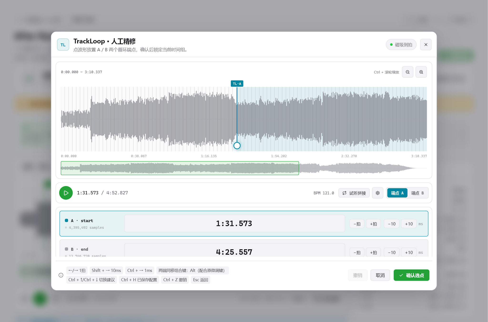
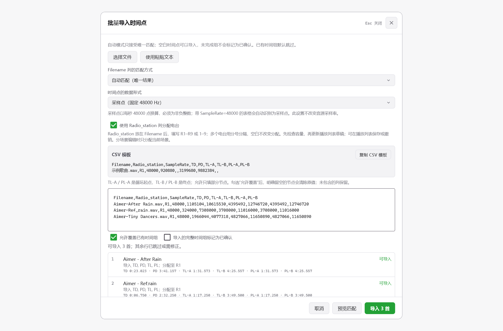
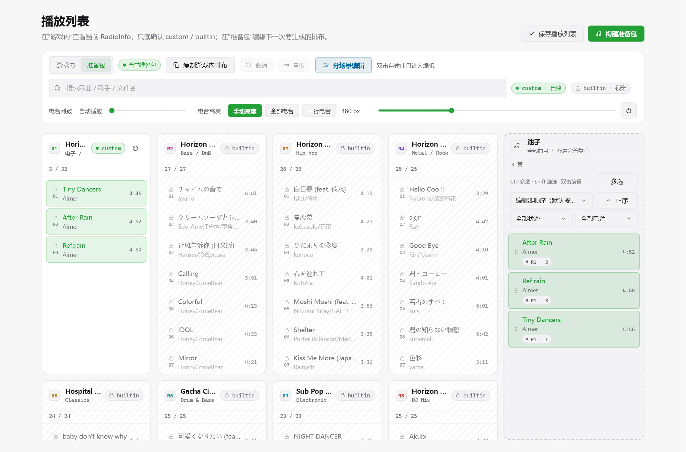
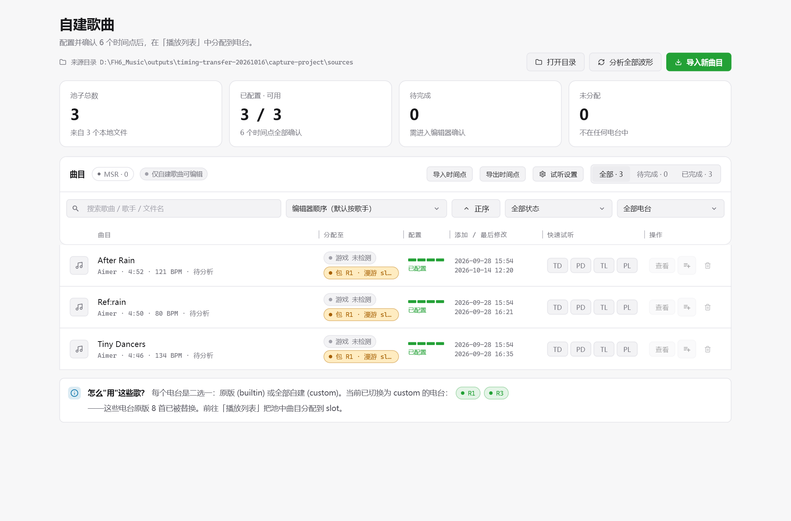

# FH Radio Studio · LoopLab：新增功能与优化概览

更新至 **2026-10-20**。以原项目源码 `fb787b6` 为比较基线；这里只说明 LoopLab 的新增能力和优化内容。

## 手动配置与循环建议

支持无 AI 模式、批量波形分析、PL 跟随 TL，以及独立的人工精修。主页面与精修窗口分别控制播放；波形支持缩放、拖动定位和全曲概览。精修以当前播放位置为缩放中心，可一键取当前播放位置；已确认的配置在未修改返回时保持确认状态。

编辑器自动将低分辨率波形缓存升级为详细数据；AI 分析保留已有详细波形，整曲与放大视图均保持细条显示。

LoopLab 集成 **SeamlessLoopMusic** 原生循环建议，在无 AI 模式下也可查找 TL/PL。支持批量分析、缓存、拼接试听和人工调整；每首歌最多提供十组候选，并非只能保存十首歌曲的配置。

## 快捷键与连续编辑

TD／PD／TL／PL 支持双击进入精修或 `Ctrl+1/2/3/4` 打开，兼容数字小键盘；`Ctrl+右键` 快速确认。精修中 `Tab` 取当前播放位置，按住 `Z` 临时自由放置，`Shift+Z` 切换磁吸；`Shift+↑/↓` 切换歌曲。常用快捷键可以自定义，界面提示同步更新。

## 时间点批量交换

支持文本、CSV、TSV、JSON、XLSX 导入和 CSV 导出，可留空时间点、预览匹配结果，并按需分配电台。支持 **48000 Hz 整数采样点**，以及直接读取 **RadioInfo XML 的赛事列表**；导入前校验数据与项目状态并保留配置备份。

导入窗口空闲时可点击外部或按 Esc 返回，处理过程中保留关闭保护。

## 播放列表与电台分配

支持单曲和多曲统一样式的快速分配、场景排布、保存、撤销和重做；`Ctrl+S` 保存，`Ctrl+Z/Y` 撤销／重做，`Esc` 退出多选。点击只改变选择，开始拖动后才显示卡片组合预览。复制游戏内排布前提示草稿变化，已保存的空列表也能保留。

游戏内电台按实际排布显示数量、锁定状态和扩容标记；锁定歌曲保持只读。未完成歌曲可以先分配，界面显示确认进度，构建前统一检查。跨场景共用的音源按实际 bank 容量校验。

## 扩容、连续构建与空间占用

电台扩容标注为实验功能。构建窗口支持响度、Vorbis 质量和九个主电台文件大小预估，提供准备包目录入口。**未变化的电台可复用已验证 bank，只重构变化的电台。**

音频统一格式转换与响度处理直接生成按槽位排列的 WAV；重复槽位优先使用硬链接，电台最终 bank 校验通过后释放对应 WAV／FSB。构建失败保留上一份完成包，并检查当前并行构建所需空间。

## 界面与资源管理

歌曲标题保留艺术家信息，分配与保存操作随窗口宽度合理排列；波形和精修区域保持紧凑。播放列表筛选与多选操作分层排列，提示消息采用清晰的浮层样式。支持自定义列宽、电台高度、界面宽度、精修窗口宽度及强调色。

项目数据采用完整写入后替换；同目标构建、导入和部署协调执行。项目切换或取消任务后，后台结果不继续更新其他项目；详细波形与循环结果可复用缓存。

完整规则见[详细版](改动说明-详细版.md)。截图来自此前的独立示例项目，主要展示两版共有界面，局部文字与当前版本可能不同。开发方式与有限测试范围见 [README](../README.md#开发说明与反馈)。
