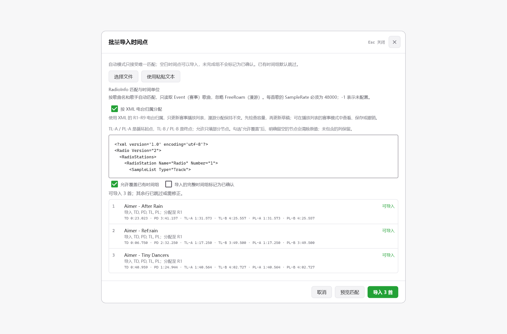

# FH Radio Studio · LoopLab：详细功能与优化说明

## 比较基线与阅读范围

更新至 **2026-10-20**，以原项目源码 `fb787b6041856a2ea8c741a81f99dbc5ccb88138` 为比较基线，说明当前 LoopLab 分支中的新增功能和优化内容；共有功能也适用于本地扩容版，本 Fork 以 LoopLab 为主要版本。

原项目已经具备歌曲导入、AI 分析、准备包构建等能力，这些能力不重复计为新增。人工精修独立撤销等上游已有功能，按沿用和适配说明。

图片来自此前独立项目中的真实界面，主要展示两版共有功能，局部文字与当前版本可能不同。本说明不作为全部功能已完成实机验证的保证；开发方式与有限测试范围见 [README](../README.md#开发说明与反馈)。简要介绍见[功能概览](改动说明-精简版.md)。

## 一、功能类：配置、分配与构建能力

### 1. 无 AI 工作流与批量波形

- 新增“无 AI”分析模式，可只读取波形并手动配置时间点，不要求运行重型分析模型。
- 新增“分析全部波形”，支持进度、缓存命中、错误信息与取消；分析波形不自动修改或确认歌曲点位。
- 波形读取独立于 AI 分析，已有详细缓存可继续复用。
- 基础设置新增循环同步、扩容等开关；塞壬唱片入口可控制显示，已在进行的导入仍保留进度入口。

### 2. PL 与 TL 同步

- 新增 PL 自动同步 TL 设置，关联循环起止点及确认状态。
- PL 卡片显示当前同步状态，可在当前歌曲本次编辑中临时取消或恢复同步。
- 全局同步关闭时提供“一键同步 TL”，只执行本次复制，不改变全局开关。
- 同步操作可撤销，内容本来一致时避免产生多余的未保存状态。

### 3. 电台扩容

- 新增后端扩容实现，不仅放宽界面数量限制，还重建新增声音所需的索引、名称、bank 结构和 XML 条目。
- 基础设置可以启用或关闭扩容，构建参数与开关状态一致。
- 未开启扩容时，分配和构建检查原版容量；关闭扩容前检查是否已经超量，超量时列出电台并阻止关闭，不自动删除歌曲。
- 漫游、比赛共用同一物理 bank，容量按跨场景去重后的音源数量检查；同一歌曲同时用于两个场景只算一个音源。
- bank 文件按小于 2 GiB 的代码限制检查，不能视为无限扩容。

### 4. 未完成歌曲先分配

- 不必先完成所有时间点，即可把歌曲分配到电台。
- 未完成歌曲使用醒目的颜色、边框和确认进度；电台显示未完成数量。
- 构建前列出未完成曲目，并可进入配置；节点未完成时禁止构建，先保留已有准备包。

### 5. 快速分配与批量分配

- 自建歌曲操作列新增快速分配入口。
- 歌曲编辑页新增“分配电台”，全部点位确认后的保存提示增加“保存并分配电台”；保存成功后再打开分配窗口。
- 分配窗口支持主键盘和数字小键盘 1–9 选择 R1–R9，显示容量并反馈满员情况。
- 播放列表池子支持多选、Ctrl 点选、Shift 连选、全选筛选结果、清空选择和批量分配。
- 同一目标列表中的重复歌曲不重复添加；超出容量时整批拒绝，分配失败不修改草稿。
- 分场景编辑开启时按场景分配，关闭时同步漫游与比赛。
- 播放列表保留拖动分配、排序及双击编辑，最终移除了其中重复的快速分配小按钮。

### 6. 播放列表持久化及撤销重做

- 增加“保存播放列表”，明确区分当前内存草稿与已保存配置，重启可恢复已保存排布。
- 成功构建后同步保存对应播放列表。
- 拖动、排序、移回池子、恢复原版及批量分配支持撤销、重做；批量操作作为一次记录。
- 当前会话最多保留 100 次记录；切换项目、丢弃草稿及清理删除的音源时清空失效历史。
- 已保存的空排布不会被旧电台内容重新填回。

### 7. 构建质量与大小预估

- 构建窗口新增 1–100 的质量滑块，默认 50，突出默认节点并提供复位按钮。
- 展示九个主电台 bank 的预计大小及其总计，不再列出其他辅助文件。
- 预估考虑当前分配、扩容及填满物理槽位时的重复曲目；跨场景重复素材去重。
- 提供名义估算值及额外 45% 余量判断；接近或超过代码限制时警告。
- 滑块不重复读取全部音源，所选质量传入实际构建；仅修改质量也可以重新构建，测试准备包继承已有质量。
- 预估失败有说明，实际构建仍检查输出大小；估算不保证最终文件大小或游戏内兼容性。

### 8. 部署目标选择

- 新增 `mediapc` 与 `media` 两种写入目标，默认使用覆盖目录 `mediapc`。
- 普通写入、测试包及强制写入入口统一选择目标并显示实际位置。
- 默认覆盖模式保留原版 `media`；原版基线操作仍读取原目录，当前播放、状态和排布重建优先识别有效覆盖层。
- 写入前先校验全部目标路径与文件；切回 `media` 时只清理能够确认属于上次部署的冲突覆盖文件，遇到其他来源覆盖层则阻止操作。
- 部署记录保存实际写入目标，逐文件替换使用独立临时文件。

### 9. 电台复用与构建空间优化

- 按电台检查输入音源、点位、编码参数和已完成产物；条件一致且 bank 校验通过时直接复用，只重构发生变化的电台。
- 格式转换与响度处理直接写入第一份槽位 WAV，重复槽位优先建立硬链接，不支持硬链接时使用复制回退。
- 每个电台的最终 bank 验证通过后释放对应 WAV／FSB，其他电台继续并行构建；显式检查用的 `--skip-bank` 模式保留槽位 WAV。
- 空间预检覆盖活跃电台、复制回退、最终包与基线补全文件；失败保留上一份完成包。自选曲源、原始备份与最终准备包继续保留。
- 构建中的同目标任务协调执行，避免两次构建共用同一输出目录；未完成结果与可用准备包分开处理。
- 播放列表与概览提供打开已构建准备包目录的入口，不必手动查找项目路径。

## 二、数据交换类：时间点导入导出

### 1. 已有批量时间数据交换能力的扩展

- 新增批量导入，支持粘贴文本、Excel 复制的带表头内容，以及 TXT、CSV、TSV、JSON、XLSX 文件。
- 新增 CSV 导出，导出已保存节点；未保存编辑不混入导出数据，CSV 带 UTF-8 BOM。
- Filename 可按文件名、歌曲名、歌曲名_歌手、歌手_歌曲名匹配；自动模式只接受唯一结果，歧义不会随意选择。
- 正式表头为 `Filename,TD,PD,TL-A,TL-B,PL-A,PL-B`；显示与编辑器一致，兼容旧 TL1/TL2/PL1/PL2 和范围列。
- 可选择在 Filename 后加入 `Radio_station`，支持 R1–R9 或 1–9，多电台以分号分隔；不开启分配时忽略该列，空白不改变分配。
- 支持不完整点位，未完成组不会自动确认。默认跳过已有时间组；开启覆盖后，明确留空的单元格可清除旧值，未包含的列保留。
- 先预览匹配结果、点位、状态及错误，再执行导入；导入前检查输入和项目快照，配置改变后需重新预览，并先备份原点位。
- 校验时间格式、范围、循环顺序、重复歌曲冲突及电台容量；拒绝重复或同义表头，限制 8 MB、10,000 行，规范显示损坏表格错误。
- 模板直接展示并可复制；导入、导出窗口统一样式，空闲时支持 Esc 返回，执行过程中避免中断。

### 2. 48000 Hz 采样点导入与导出

- 导入和导出窗口新增“时间点的数据形式”：时间或采样点。原有时间模式与空节点规则继续保留。
- 采样点固定以 **48000 Hz** 为基准：秒数 = 采样点 ÷ 48000。采样点是每声道的帧位置，不乘声道数；本功能不修改原音源采样率。
- 采样点导出取最近的整数位置，不经过毫秒显示字符串转换；来自整数采样点的数据可往返保留单个采样点的精度。
- 采样点 CSV 自动带 `SampleRate` 列，每行固定填写 `48000`。重新导入时可自动识别；没有此列时，可在窗口中明确选择采样点形式。
- 提供了采样率列却留空、填写其他采样率，或采样点为小数、负数、NaN、无穷值时，该行不能导入。普通 CSV 的空节点继续用空单元格表示。
- JSON 可以使用 `markers_samples`，或通过 `sample_rate: 48000` / `time_unit: "samples"` 明确单位；仍保留 `markers_sec` 的秒数语义。
- 时间单位、格式及相关设置纳入预览校验。预览后改单位必须重新预览，防止按旧结果写入。
- 导出仍使用已保存的节点；如包含电台列，读取已保存的播放列表，不包含未保存草稿。

采样点 CSV 示例（可选电台列紧跟 Filename）：

```csv
Filename,Radio_station,SampleRate,TD,PD,TL-A,TL-B,PL-A,PL-B
示例歌曲.wav,R1,48000,920880,,3199680,9882384,,
```

示例中的 `920880` 对应 19.185 秒；空白节点保持未配置。


### 3. 直接导入 RadioInfo XML

- 文件选择支持 `.xml`；也可以粘贴 RadioInfo XML 内容。解析在 Python CLI 中完成，界面不维护另一套歌曲匹配规则。
- **只读取 R1–R9 的 Event（赛事）播放列表**，忽略 FreeRoam（漫游）及非歌曲条目。没有 Event 列表时不退回读取全部 Sample。
- 用 Event Entry 的 Name 关联本电台 Track Sample 的 SoundName，再按 DisplayName 与 Artist 唯一匹配本地歌曲。不会因复用原游戏 SoundName 而直接套到不相关的本地歌曲。
- 每首歌曲的 `SampleRate` 必须明确为 `48000`；读取六个节点属性，也兼容 Marker 子节点。属性与 Marker 冲突时提示修正。
- XML 的 `-1` 识别为未配置节点。导入仍遵循默认保护已有组、可选覆盖、完整组可选确认的规则。
- 默认只导入节点。勾选“按 XML 电台归属分配”后，先检查容量，再把匹配到的归属加入**赛事播放列表草稿**；漫游排布保持不变，可到赛事模式查看、保存或撤销。
- 同一首歌曲在多个电台中具有相同节点时合并归属；节点冲突、匹配歧义、文件不存在或超出歌曲时长时，不擅自选择一套配置。
- XML 不导入音频本身、不修改游戏文件，也不把未匹配歌曲自动创建为本地歌曲。
- 依旧先预览再确认写入，保留自动备份和项目变化检查；容量不足时不执行这次导入。



## 三、操作体验类：编辑、试听与快捷键

### 1. 连续编辑与返回

- 编辑页新增上一首、下一首、当前序号；首尾循环。
- 顺序沿用进入时的歌曲筛选/排序、电台顺序或池子顺序，过滤已删除歌曲，避免连续切换跳错来源。
- 自建曲目可双击进入编辑；游戏内锁定歌曲保持只读，并按是否可编辑显示对应提示。
- 从播放列表进入时，返回按钮与 Esc 回到来源页面，保留会话内搜索、筛选和滚动状态。
- 返回、换歌、关闭窗口前处理未保存内容，可保存、放弃或取消；Windows 原生关闭按钮也接入保护。

### 2. 人工精修

- 四个配置卡片支持双击进入精修，并提供 Ctrl+右键快速确认与文字提示；刚打开歌曲时不额外突出某个配置卡片。
- 已确认配置在再次进入后，未更改时间点便关闭或 Esc 返回，保持原确认状态。
- 主界面与精修窗口各自控制播放进度；精修缩放以当前播放位置为中心，Tab 可把当前播放位置写入选中时间点。
- 按住 Z 临时自由放置，Shift+Z 在磁吸到拍与自由放置之间切换；Ctrl+H 仅恢复已保存配置。
- 新增按住按钮或快捷键连续微调，约 500 ms 后开始，约每 90 ms 一步。
- 松开或更改修饰键/同移组合键后停止重复，方向键需重新按下才继续，避免步长意外改变；失焦等退出状态停止长按。
- 循环两端可一起平移，保持循环长度，到边界一起停止。
- 上游当前源码已经加入精修草稿独立撤销，本版保留并适配扩展后的时间输入、点选、拖动、建议切换和连续微调流程；不把上游已有的独立撤销重复计作新增功能。
- 支持上一条/下一条建议和恢复磁盘已保存配置，恢复与套用均可撤销，再由确认操作提交。
- 保存只刷新歌曲信息，保留波形、缩放及当前会话，不无故重建编辑器。
- 时间输入支持秒数、分:秒.毫秒、时:分:秒及带单位格式；统一三位毫秒和跨分钟进位，非法输入有提示。

### 3. 快捷键自定义

- 设置新增快捷键录入弹窗，支持保存、恢复默认、冲突检测和 Esc 取消；界面提示随自定义值更新。
- 两端同移只设置一个额外组合键，默认 Alt；可录入无冲突的字母、功能键或修饰键，配合原微调键共同使用。
- 歌曲页只显示单张组合键卡片，精修提示只解释这个额外键，不再列六组重复组合。
- 保留旧默认快捷键迁移和自定义配置兼容；上一首、下一首提示放在最后。

| 操作 | 当前默认快捷键 |
| --- | --- |
| 播放/暂停 | Space |
| 确认当前选点 | Enter |
| 后退/前进一拍 | ← / → |
| 减少/增加 10 ms | Shift+← / Shift+→ |
| 减少/增加 1 ms | Ctrl+← / Ctrl+→ |
| 两端同移额外组合键 | Alt |
| 撤销 | Ctrl+Z |
| 精修上一条/下一条建议 | Ctrl+↑ / Ctrl+↓ |
| 精修恢复已保存配置 | Ctrl+H |
| 分配电台 | Ctrl+D |
| 保存歌曲／播放列表 | Ctrl+S |
| 播放列表重做 | Ctrl+Y |
| 人工精修 TD／PD／TL／PL | Ctrl+1 / Ctrl+2 / Ctrl+3 / Ctrl+4，兼容小键盘 |
| 精修取当前播放位置 | Tab |
| 精修按住自由放置 | Z |
| 精修切换磁吸／自由放置 | Shift+Z |
| 上一首/下一首 | Shift+↑ / Shift+↓ |

### 4. 试听

- 新增统一试听设置，前后各 0.5–10 秒、1–10 次或持续循环、音量 0–100%；当前默认循环一次、前后各两秒，保留已有自选参数。
- 列表、编辑器和精修共用设置，循环试听围绕 B→A 拼接，不是整首重复。
- 改进试听会话及播放器复用，减少换页、返回时销毁原生播放器造成的阻塞。
- 四个快速试听按钮改为紧凑矩形，统一间距、字体与停止标记居中。

## 四、波形显示与定位类


- 增加独立高分辨率波形读取与视图缓存；保留细条风格，缩放时使用当前范围的详细数据。
- 调整显示聚合及振幅映射，保留强弱动态，避免过度拉伸或大量条形挤在上限；静音仍为静音。
- 主波形与精修波形采用紧凑高度；彩色标记、播放线和阴影与波形区域对齐，优先为精修端点和操作区域保留空间。
- 没有段落数据时不预留空段落栏，减少精修上方空白。
- 主界面和精修均支持 Ctrl+滚轮缩放；提示放在放大镜旁，普通滚轮仍滚动页面。
- 精修新增与主界面相同的全曲概览，高亮框表示可见范围，可点击/拖动平移，保持缩放比例，不修改时间点或播放位置。
- 放大播放时，指针进入边缘约 10% 后一次翻页；视窗内不持续滚动，保留观察和选点空间，循环跳转可重新定位。
- 波形与节拍按钮控制对应显示；没有可靠段落数据时不提供独立段落切换入口。
- 主编辑页去掉重复时间读数及大块候选区，建议集中在人工精修侧栏；普通窗口仍显示必要播放信息。

## 五、界面与布局类


- 新增界面宽度调节、原始/适应快捷按钮和人工精修窗口宽度设置；精修加宽主要给左侧波形，右侧建议列保持原宽度。
- 顶部 Tab 设置改为悬浮，左侧栏沿用就地展开；面板高度更充分利用可用窗口，短窗口可滚动。
- 任意强调色支持色盘、色相/饱和度/明度、十六进制输入、预览及持久化，按钮文字自动选择对比色。
- 电台列数支持自动和 2–6 列，扣除池子与间距后按最小列宽限制，禁止选到放不下的更多列；窄窗口可堆叠池子。
- 电台高度直接滑动，手动范围 160–1200 px，默认 480 px 有标记和复位；“全部电台”“一行电台”持续适配窗口和列数。
- 一行模式停止滚动约 0.7 秒后吸附到行起点，继续操作则重新计时；不干扰内部歌曲列表滚动。
- 自建歌曲表格支持拖动调整列宽、各列最小宽度与双击恢复默认；窄窗口保留可访问的横向滚动。
- 统一表头/数据起点、分隔线与操作列位置；添加和修改时间都显示到分钟，字号一致，日期列最小宽度缩小；去掉末尾无效竖线。
- 基础设置文字、开关及来源说明按钮对齐；自建歌曲说明恢复在标题下方，适当压缩模块间空白。
- 来源目录和右侧按钮分别预留空间，收窄窗口不互相覆盖，完整路径可悬停查看；播放列表工具栏同样调整窄窗口排列。
- 分场景编辑与排布操作集中在顶部；池子先显示排序／过滤，再显示多选操作，多选分配按钮靠右，Esc 可退出多选。
- 多选时普通点击只改变选择，超过拖动阈值后才显示组合卡片与数量；批量分配使用与单曲一致的电台选项和容量反馈。
- 歌曲标题下保留艺术家；分配状态与保存按钮按可用宽度排列，窄窗口的 AI／快捷键入口不遮挡主操作。
- 准备包响度和质量窗口减少无效留白；提示消息使用有边界与状态区分的浮层，长消息可阅读和关闭。
- 点击设置面板外的主界面区域可关闭设置；快捷键说明按空间合理排列。
- 电台拖动点和序号合并为窄列，保留原排列序号，给歌曲名更多宽度；徽标在窄卡片内可换行。
- 深色模式统一筛选文字亮度，快速试听采用灰色文字；修正输入框等宽字形、字号与时间显示。
- 自建歌曲和播放列表池子新增/改进回到顶部按钮，按钮略大、上移并用彩虹边框；远距离使用淡出定位再淡入的方式减少长列表卡顿。

## 六、检索与性能类

- 两页统一搜索歌曲、歌手、文件名，搜索文字与过滤结果共同保留，清空后立即恢复结果。
- 统一编辑器顺序、歌曲名、修改日期排序及正序/倒序，支持配置状态、分配状态、电台和“可能重复”筛选。
- “可能重复”按曲名、歌手与近似时长筛查，供人工核对；音频导入对完全相同文件内容另做哈希去重并提醒，保留旧曲目及点位。
- 多选只刷新必要池子区域；电台和曲目卡片按可见范围创建，调整布局复用已有内容及内部滚动状态。
- 建立一次分配索引，减少每首歌曲反复全表查找；元数据索引按文件状态缓存，避免不相关状态变化反复读取。
- 拖动高度、列数及列宽时延后合并保存偏好，列宽按起始几何位置及鼠标位移计算，减少不跟手和积累误差；结束/退出时补存。
- 主题切换减少中间过渡帧；播放器提前准备、跨页面复用，改善进入列表、切换页面和返回的延迟。
- 波形和循环建议使用内存/磁盘缓存，同源任务协调执行，切换项目和取消任务后避免旧结果污染新界面。

## 七、稳定性、兼容与错误处理类

- Dart 和 Python 项目 JSON 改用完整写入后替换；独立临时名称、刷新数据、失败清理和 Windows 短暂占用重试降低半份文件和写入冲突风险。
- 已损坏的项目设置、时间点、播放列表不再被空数据静默覆盖；需要迁移的项目启动时不先写入默认设置。
- 元数据读改写增加线程/进程协调与读取重试，失败明确报告；波形缓存串行合并，不让低分辨率结果覆盖详细数据。
- 时间点完整性检查同时验证实际六个点、有限值及循环顺序，而不是仅看确认标记。
- 去掉前端按歌曲名和歌手猜测音源的回退，使用已有权威映射；同一实际文件的旧路径标识和持久化标识统一去重。
- 完整性检查使用实际生效的覆盖层及最新差异结果，统一“原版／已覆盖／已改变”的状态判断。
- Dart 网络请求接入现有系统代理和环境代理，统一覆盖目录、封面与音频，本地回环绕过代理；保持正常证书校验，TLS 失败有可读提示。
- 中文程序显示名与 HTTP User-Agent 分开处理，避免中文标题进入请求头造成异常。
- 两个版本使用独立偏好命名空间，验证项目另行隔离；最终源码不硬编码个人项目目录。

## 八、循环分析版独有改动

- 接入 CPUrising / SeamlessLoopMusic 的 loopfinder 原生引擎，以可选实验功能提供 TL/PL 循环建议；扩容版不包含该入口。
- 无 AI 模式也可使用，不依赖重型模型；AI 模式保留节拍、结构及 TD/PD 分析，把循环搜索替换成原生结果，避免旧算法再次改写原生候选。
- 每首歌曲最多请求十组有效建议，在精修侧栏套用；这不是可保存歌曲的数量上限。保留已保存配置便于对比，去除完全相同的重复项，支持快捷键切换及恢复。
- 新增“分析全部循环”，串行处理、可取消，显示进度、缓存和错误，不自动确认或覆盖歌曲时间点。
- 缓存随音源、大小、修改时间、引擎内容和参数变化失效；缺组件、无结果或非法区间时提示，继续允许手动配置。
- 处理中文/日文路径、原采样率和 PCM 帧到时间的转换；临时解码不改原音源，原生分析在独立可取消进程中运行。
- 基础设置解释功能与来源，提供“原项目 GitHub”按钮，按钮与开关对齐；移除后来要求删除的冗余建议文字。
- 匹配百分比是算法评分，不代表拼接必然自然或游戏内已验证。

## 九、工程与任务协调

- 单个电台与多个电台共用音频准备和产物校验流程，集中处理文件锁、事务和参数校验。
- 部署与基线操作先预检、暂存，再替换目标；失败时尝试回滚，保留上一份完整结果。
- 同项目导入、同游戏写入与同目标构建互斥；后台分析、试听和下载使用会话标识，项目切换后不更新新项目。
- Windows 取消处理 CLI 及其子进程；已取消请求不再启动新的分析工作。
- JSON、FSB、路径、时间点、容量和缓存输入均在使用前检查；坏缓存按未命中处理，已损坏的用户配置不替换为空白数据。
- 快捷键、按钮语义、目录选择生命周期、退出时保存检查和试听请求顺序统一处理。
- 提供贡献指南、PR 模板及本地检查入口，保留原项目历史与来源说明。

## 十、使用与阅读边界

- 电台扩容和原生循环建议属于实验功能，实际游戏表现仍需在相应版本中验证。
- 两端同移默认使用 Alt 配合原微调键；自由放置使用 Z，两者是不同操作，均可按设置调整。
- 时间交换列名为 TL-A／TL-B／PL-A／PL-B；采样点形式固定 48000 Hz，未包含的列与明确留空的列按不同规则处理。
- 波形数据、AI 结果、循环候选和已确认配置各自管理，批量分析不等于批量确认。
- 这些说明记录功能与优化，不将自动化测试通过解释为所有操作、音源或游戏环境均已验证。
- 第三方原生库与工具需分别核对来源和许可，不能因顶层项目使用 MIT 就推定所有二进制均可按 MIT 分发，见[来源与分发说明](third-party-notices.md)。
